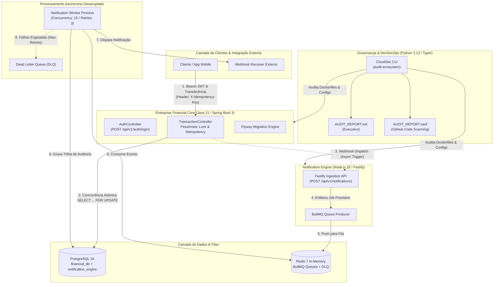

# 🌐 Enterprise Financial & Event-Driven Ecosystem

[](https://github.com/ViktorGabriel/enterprise-microservices-ecosystem/actions/workflows/e2e.yml)
[](https://www.oracle.com/java/)
[](https://spring.io/projects/spring-boot)
[](https://nodejs.org/)
[](https://fastify.dev/)
[](https://bullmq.io/)
[](https://www.python.org/)
[](https://github.com/ViktorGabriel)
[](https://www.docker.com/)

> **Meta-repositório e Orquestração de Microsserviços Corporativos**: Ecossistema resiliente de alta volumetria que integra um **Core Bancário Transacional** em Java 21, um **Motor de Eventos e Notificações Assíncronas** em Node.js com BullMQ/Redis e uma **Plataforma CLI DevSecOps** em Python 3.12 para governança e auditoria de segurança contínua.

---

## 🏛️ Visão Geral da Arquitetura do Ecossistema

O ecossistema é projetado sob os padrões de **Clean Architecture**, **Hexagonal Architecture** e **Event-Driven Architecture (EDA)**, unificando três serviços complementares desacoplados:

1. **[`enterprise-financial-api`](./enterprise-financial-api)**: Core transacional bancário com suporte a controle de concorrência com travas pessimistas, ordenação determinística de locks para eliminação de deadlocks, idempotência estrita via `X-Idempotency-Key` e auditoria de saldos em tempo real.
2. **[`notification-event-engine`](./notification-event-engine)**: Motor de mensageria assíncrona de alto throughput alimentado por Fastify, BullMQ, Redis e PostgreSQL (Prisma), com workers desacoplados, retry exponencial e roteamento para Dead Letter Queue (DLQ).
3. **[`cloudsec-cli`](./cloudsec-cli)**: Ferramenta de auditoria estática e dinâmica DevSecOps construída com Typer e Pydantic v2, responsável pela varredura contínua de Dockerfiles, detecção de segredos por entropia de Shannon e geração de relatórios de conformidade em Markdown e SARIF v2.1.0 para o GitHub Security.



---

## 💡 Justificativa das Decisões Técnicas

| Decisão Arquitetural | Problema Mitigado | Implementação e Benefício |
| :--- | :--- | :--- |
| **Concorrência com Trava Pessimista (`PESSIMISTIC_WRITE`)** | *Race conditions*, leituras fantasmas e saldo negativo durante requisições simultâneas de débito. | `AccountRepositoryPort.findByIdWithLock` utiliza `SELECT ... FOR UPDATE` no PostgreSQL, garantindo que o saldo seja recalculado com exclusividade transacional estrita em nível de linha. |
| **Ordenação Determinística de Locks por UUID** | Deadlocks clássicos do banco de dados quando a Conta A transfere para a Conta B simultaneamente à transferência da Conta B para a Conta A. | O serviço ordena os identificadores das contas lexicograficamente antes de solicitar os locks (`sourceAccountId.compareTo(targetAccountId)`). Todos os processos disputam recursos na mesma ordem determinística, erradicando deadlocks. |
| **Idempotência Estrita via `X-Idempotency-Key`** | Duplicação acidental de transações por *network retries*, *timeouts* do cliente ou reenvio de formulários. | A chave de idempotência é persistida com *unique constraint*. Requisições idênticas retornam a transação já consolidada instantaneamente, sem aplicar novos débitos à conta. |
| **Desacoplamento Assíncrono com BullMQ & Redis** | Degradação de latência na API bancária decorrente do envio bloqueante de e-mails, SMS e webhooks externos. | A API aceita o evento em tempo inferior a 15ms gravando o status `QUEUED`. Workers independentes processam em lote com retentativas exponenciais, protegendo o *uptime* do core. |
| **Dead Letter Queue (DLQ) & Lifecycle Audit** | Perda silenciosa de eventos em caso de falha permanente de serviços terceiros ou servidores fora do ar. | Notificações com 3 falhas consecutivas são automaticamente movidas para a DLQ com evento `DISPATCH_EXHAUSTED` e gravadas na tabela `notification_audit_logs`. |
| **Auditoria DevSecOps Nativa (CloudSec CLI)** | Vazamento de credenciais, imagens executando como root e configurações inseguras em repositórios corporativos. | Scanner estático em Python 3.12 com suporte a cálculo de entropia de Shannon e saída SARIF v2.1.0, integrável nativamente ao GitHub Code Scanning e pipelines de CI/CD. |

---

## 🚀 Guia Rápido de Execução (Quickstart)

O ecossistema foi projetado para subir localmente de forma unificada através do Docker Compose, com scripts automatizados de validação de ponta a ponta e auditoria de segurança.

### 0. Clonar o Meta-Repositório com Submódulos

```bash
# Clone recursivo (traz todos os submódulos automaticamente)
git clone --recursive https://github.com/ViktorGabriel/enterprise-microservices-ecosystem.git
cd enterprise-microservices-ecosystem

# Se já clonou sem a flag --recursive, inicialize os submódulos:
git submodule update --init --recursive
```

### 1. Inicializar todo o ecossistema com Docker Compose

Suba os bancos (PostgreSQL com provisionamento multi-database e Redis), a API Java, a API Fastify e o Worker desacoplado em background:

```bash
docker compose up -d --build
```

> **Verificação de Saúde**: Os contêineres contam com probes de *healthcheck* configurados. O PostgreSQL é inicializado e executará automaticamente a criação de schemas isolados (`financial_db` e `notification_engine`).

---

### 2. Executar o Teste de Integração Ponta a Ponta (E2E)

Valide a autenticação JWT, a abertura de contas, a transferência atômica com idempotência e o disparo assíncrono para a fila de mensageria:

```bash
# No Linux / macOS / WSL:
./test-e2e.sh

# No Windows (PowerShell):
.\test-e2e.ps1
```

O teste automatizado executará o seguinte fluxo:
1. `POST /api/v1/auth/login` ➔ Autentica e extrai o Bearer JWT.
2. `POST /api/v1/accounts` ➔ Provisiona a conta de origem (`R$ 1.000,00`) e a conta de destino (`R$ 250,00`).
3. `POST /api/v1/transactions/transfer` ➔ Executa transferência de `R$ 150,00` enviando cabeçalho `X-Idempotency-Key`.
4. Reenvia a mesma requisição com o mesmo token e valida que **nenhum débito adicional é executado**.
5. `POST /api/v1/notifications` ➔ Dispara evento na Notification Engine com o payload da transação.
6. Acompanha o ciclo de vida do evento no BullMQ Worker (`QUEUED` ➔ `PROCESSING` ➔ `DELIVERED`).

---

### 3. Executar Auditoria DevSecOps do Ecossistema

Execute a ferramenta Python local para varredura estática de segurança e emissão dos relatórios de conformidade:

```bash
# No Linux / macOS / WSL:
./audit-ecosystem.sh

# No Windows (PowerShell):
.\audit-ecosystem.ps1
```

Artefatos gerados na raiz:
- 📄 **[`AUDIT_REPORT.md`](./AUDIT_REPORT.md)**: Relatório executivo em Markdown com sumário de vulnerabilidades e remediações recomendadas.
- 🛡️ **[`AUDIT_REPORT.sarif`](./AUDIT_REPORT.sarif)**: Relatório padronizado OASIS SARIF v2.1.0 para visualização na aba *Security / Code scanning* do GitHub.

---

## 📂 Estrutura de Diretórios do Ecossistema

```text
.
├── .github/
│   └── workflows/
│       └── e2e.yml                 # Pipeline CI/CD com submodules recursivos e CodeQL SARIF
├── .gitmodules                     # Mapeamento oficial dos Git Submodules
├── docker-compose.yml              # Orquestrador unificado de todos os serviços e bancos
├── test-e2e.ps1                    # Suíte de teste ponta a ponta (PowerShell)
├── test-e2e.sh                     # Suíte de teste ponta a ponta (Bash)
├── audit-ecosystem.ps1             # Runner da auditoria DevSecOps (PowerShell)
├── audit-ecosystem.sh              # Runner da auditoria DevSecOps (Bash)
├── AUDIT_REPORT.md                 # Relatório de auditoria de segurança gerado pela CLI
├── AUDIT_REPORT.sarif              # Relatório SARIF v2.1.0 gerado pela CLI
├── .gitignore                      # Padrão enterprise com política de zero vazamentos
│
├── docker/
│   └── postgres/
│       └── init-databases.sql      # DDL de inicialização automática multi-database
│
├── enterprise-financial-api/       # [Git Submodule] Core Financeiro (Java 21 / Spring Boot 3)
│   ├── Dockerfile                  # Multi-stage build com Eclipse Temurin JRE e non-root user
│   ├── pom.xml                     # Dependências Spring Data JPA, Security, Flyway, Actuator
│   └── src/main/java/              # Arquitetura Hexagonal (Domain, Ports, Adapters)
│
├── notification-event-engine/      # [Git Submodule] Motor de Eventos & Notificações (Node 22 / Fastify)
│   ├── Dockerfile                  # Multi-stage build Node.js Alpine com non-root user
│   ├── package.json                # Fastify, BullMQ, Redis, Prisma, Vitest
│   ├── prisma/schema.prisma        # Modelo relacional com índices de alta performance
│   └── src/                        # Rotas, adaptadores (Webhook, Email, SMS) e Workers
│
└── cloudsec-cli/                   # [Git Submodule] Ferramenta DevSecOps CLI (Python 3.12 / Typer)
    ├── Dockerfile                  # Multi-stage image baseada em UV e non-root user
    ├── pyproject.toml              # Typer, Rich, Pydantic v2, PyYAML, Docker SDK
    ├── src/cloudsec/               # Parsers, Scanners (Entropia, Dockerfile, Segredos) e Reporters
    └── tests/                      # Cobertura de testes unitários com Pytest
```

---

## 🔒 Conformidade e Boas Práticas DevSecOps

- **Imagens Não-Privilegiadas**: Todos os contêineres definem diretivas de usuário não-root (`USER appuser`, `USER node`, `USER cloudsec`) mitigando riscos de *container breakout*.
- **Minimização de Superfície de Ataque**: Uso de imagens base mínimas (`alpine` e `slim`) e multi-stage builds para descartar compiladores e dependências de build no ambiente de execução.
- **Gestão de Segredos**: Ausência de segredos ou tokens hardcoded; injeção transparente via variáveis de ambiente compatíveis com HashiCorp Vault e Kubernetes Secrets.
- **Zero-Leak Policy**: Configuração estrita de `.gitignore` impedindo versionamento de artefatos temporários de agentes, credenciais e caches de compilação.

---

## 👨‍💻 Autor

Desenvolvido por **Viktor Gabriel**  
- GitHub: [@ViktorGabriel](https://github.com/ViktorGabriel)  
- LinkedIn: [Viktor Gabriel](https://linkedin.com/in/viktorgabriel)
